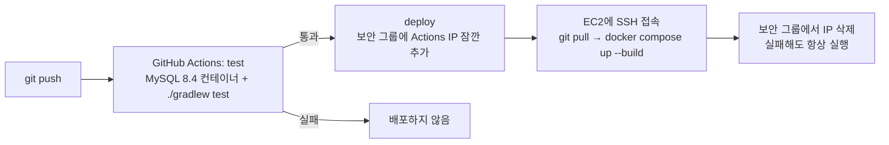

# practice-backend

Spring Boot로 만든 **게시판 백엔드 API**입니다.
백엔드를 처음부터 공부하면서 CRUD → 테스트 → DB 마이그레이션 → 성능(N+1) → Docker → CI/CD → AWS 배포까지 한 바퀴를 직접 만들었습니다.

## 기술 스택

| 분류 | 사용 기술 |
|---|---|
| 언어 / 프레임워크 | Java 17, Spring Boot 4.1 (Spring MVC, Spring Data JPA, Validation) |
| DB | MySQL 8.4, Flyway (스키마 마이그레이션) |
| 테스트 | JUnit 5, MockMvc(`@WebMvcTest`), `@SpringBootTest` + 실제 MySQL |
| 인프라 | Docker (멀티 스테이지 빌드), Docker Compose |
| CI/CD | GitHub Actions |
| 배포 | AWS EC2 (Ubuntu, Arm) |

## 배포 흐름

`main`에 push하면 테스트부터 배포까지 자동으로 진행됩니다.



- 테스트가 실패하면 배포 단계는 실행되지 않습니다 (`needs: test`).
- 평소 EC2의 SSH 포트는 관리자 IP에만 열려 있고, 배포하는 동안에만 GitHub Actions의 IP를 추가했다가 지웁니다.
- 배포용 IAM 사용자는 **이 보안 그룹의 규칙 추가·삭제 권한만** 가집니다.
- 배포용 SSH 키는 서버에서 **배포 스크립트 하나만 실행**하도록 제한되어 있습니다 (`authorized_keys`의 `command=`).

## API

| 메서드 | 주소 | 설명 |
|---|---|---|
| POST | `/posts` | 글 작성 (201) |
| GET | `/posts?page=0&size=10` | 글 목록 (최신순, 페이지 크기 최대 50, 글마다 댓글 수 포함) |
| GET | `/posts/{id}` | 글 조회 |
| PUT | `/posts/{id}` | 글 수정 |
| DELETE | `/posts/{id}` | 글 삭제 (204, 달린 댓글도 함께 삭제) |
| POST | `/posts/{postId}/comments` | 댓글 작성 (201) |
| GET | `/posts/{postId}/comments` | 글의 댓글 목록 |
| GET | `/comments/recent` | 전체 최근 댓글 10개 (글 제목 포함) |

에러는 모든 API에서 같은 형식으로 응답합니다.

```json
{ "code": "POST_NOT_FOUND", "message": "게시글을 찾을 수 없습니다." }
```

## 실행 방법

### 1. Docker로 실행 (권장)

Java나 MySQL을 설치하지 않아도 됩니다. Docker만 있으면 됩니다.

```bash
cp .env.example .env      # .env를 열어 DB_PASSWORD 값을 채운다
docker compose up -d --build
curl http://localhost:8081/posts
```

- 서버: `localhost:8081`, MySQL: `localhost:3307`
- 테이블은 서버가 켜질 때 Flyway가 자동으로 만듭니다.
- DB 데이터는 Docker 볼륨에 저장되어 컨테이너를 지워도 남습니다. 초기화하려면 `docker compose down -v`.

### 2. IntelliJ에서 개발용으로 실행

로컬 MySQL에 `board` DB와 `board` 사용자를 만든 뒤, 프로젝트 루트에 `secret-local.yml`을 만듭니다 (Git에 올라가지 않음).

```yaml
DB_PASSWORD: 내_로컬_DB_비밀번호
```

```bash
./gradlew bootRun    # localhost:8080
./gradlew test       # 테스트 (로컬 MySQL 필요)
```

## 프로젝트 구조

```
src/main/java/com/practice/board
├── global/        ← 모든 기능이 함께 쓰는 것 (에러 처리, 공통 응답, JPA 설정)
└── domain/
    ├── post/      ← controller / service / repository / entity / dto
    └── comment/
src/main/resources/db/migration   ← Flyway 마이그레이션 (V1, V2, V3 ...)
```

## 만들면서 겪은 문제와 해결

| 문제 | 원인 | 해결 |
|---|---|---|
| 글 목록 10개에 SQL 12번 | 글마다 댓글 수를 따로 조회 (N+1) | `in` + `group by`로 한 번에 조회 → 3번 |
| 최근 댓글 10개에 SQL 9번 | 글 제목을 꺼낼 때마다 지연 로딩 (N+1) | `join fetch` → 1번 |
| 글 삭제 시 500 에러 | 댓글이 외래 키로 글을 참조 | 댓글을 먼저 일괄 삭제 (`@Modifying` + flush/clear) |
| 컨테이너에서 DB 연결 실패 | 컨테이너 안의 `localhost`는 컨테이너 자신 | Compose 서비스 이름(`mysql`)으로 접속 |
| CI에서 `@SpringBootTest`만 실패 | GitHub Actions 환경에 MySQL이 없음 | 서비스 컨테이너로 MySQL 8.4 실행 |
| 맥에서는 통과, CI(리눅스)에서만 테스트 실패 | 리눅스 Java는 시간을 나노초(9자리)까지, DB `DATETIME(6)`은 마이크로초(6자리)까지 저장 | JPA Auditing 시간을 마이크로초로 맞춤 (`DateTimeProvider`) |
| 서버 시간이 9시간 느림 | 컨테이너 기본 시간대가 UTC | 이미지에 `TZ=Asia/Seoul` |
| 자동 배포 시 SSH timeout | 보안 그룹이 관리자 IP만 허용 | 배포 중에만 Actions IP를 추가하고 항상 삭제 |
